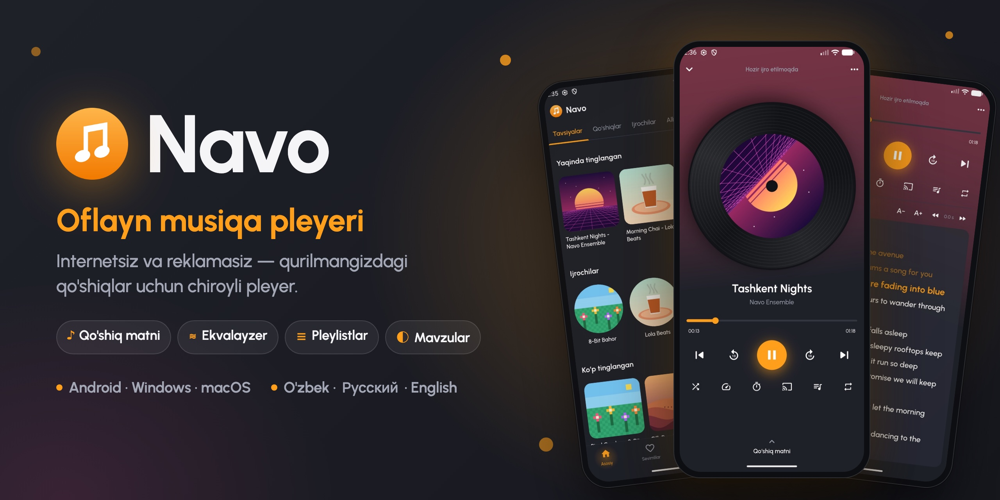
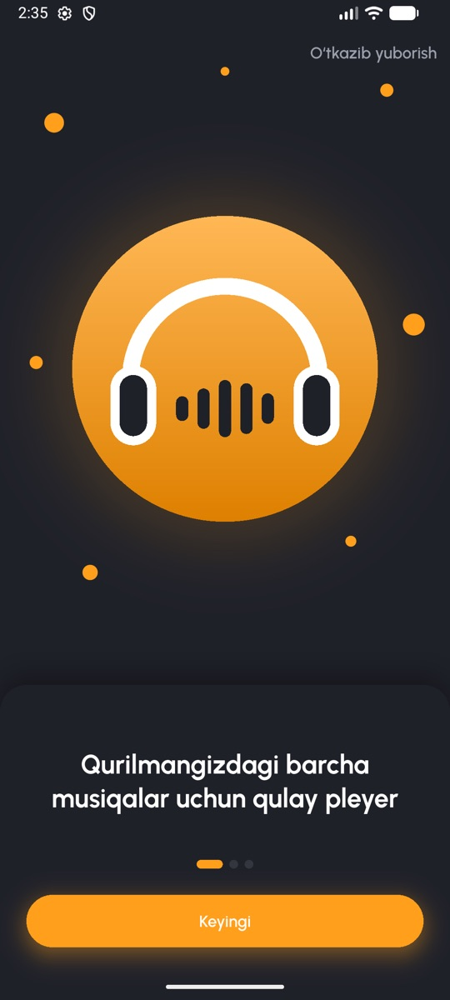
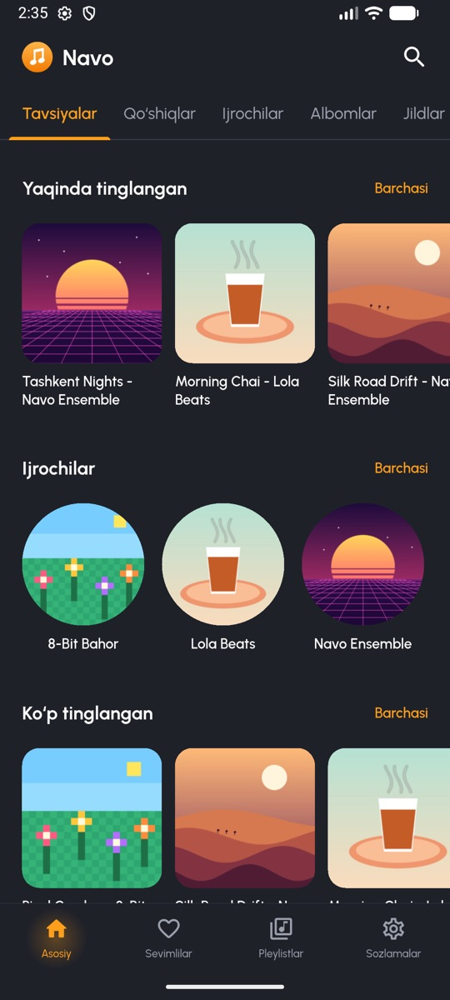
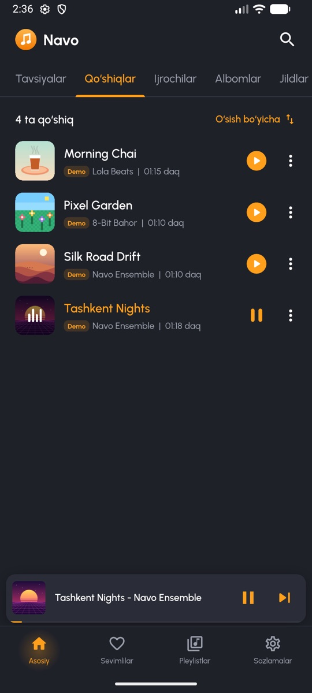
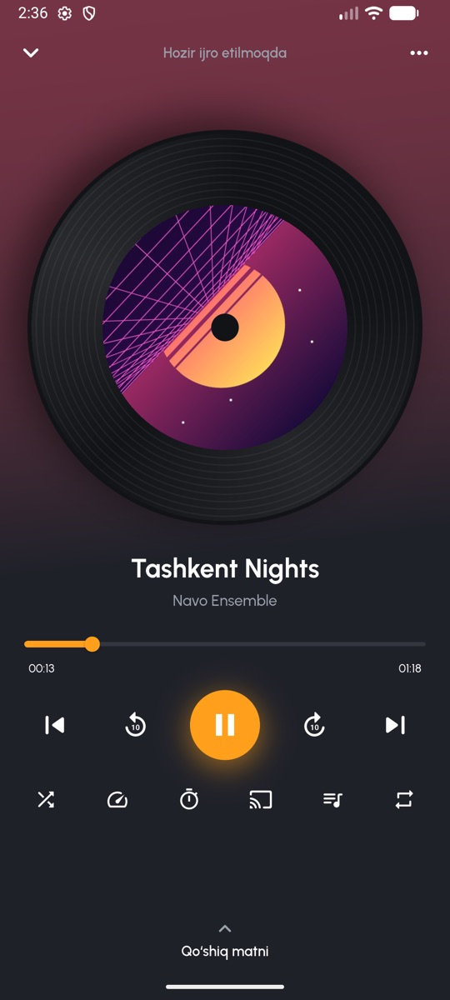
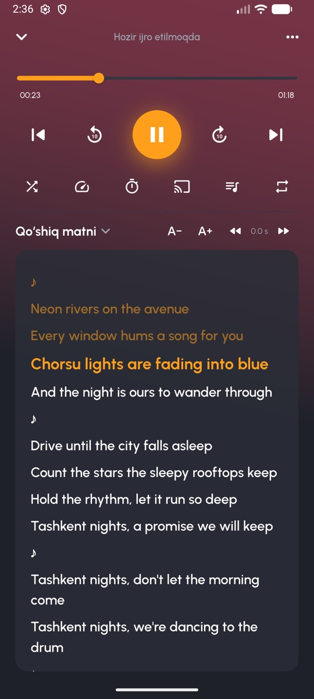
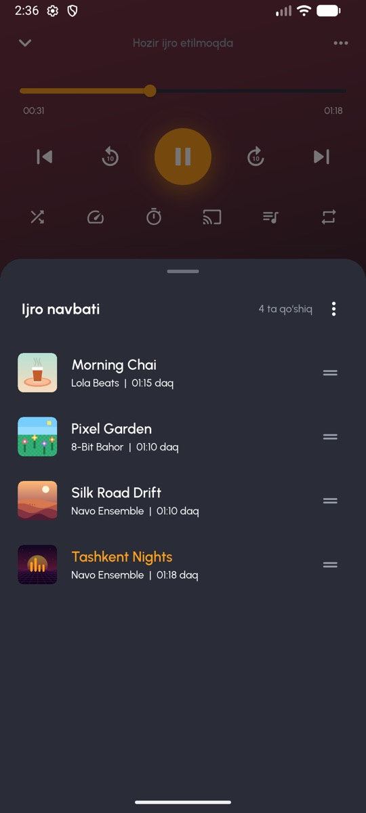
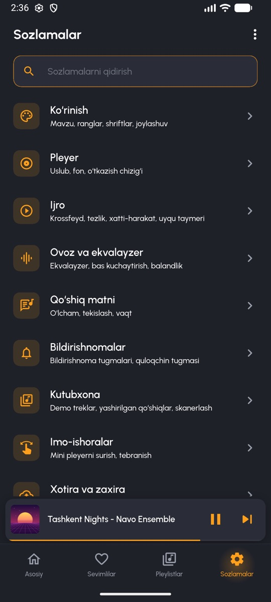
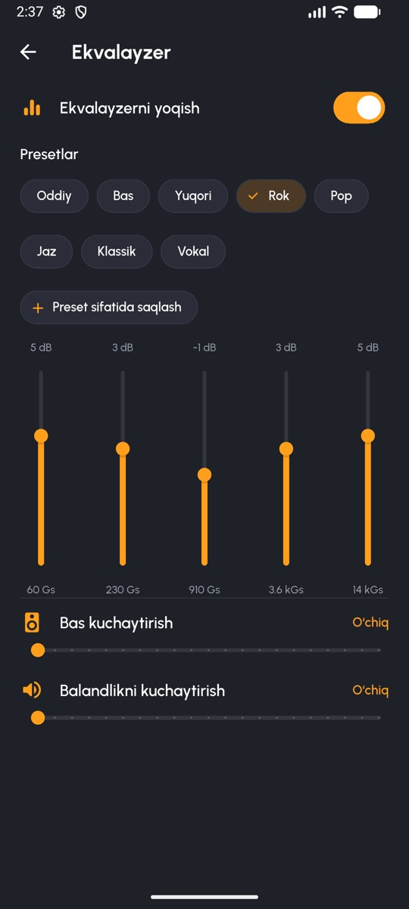
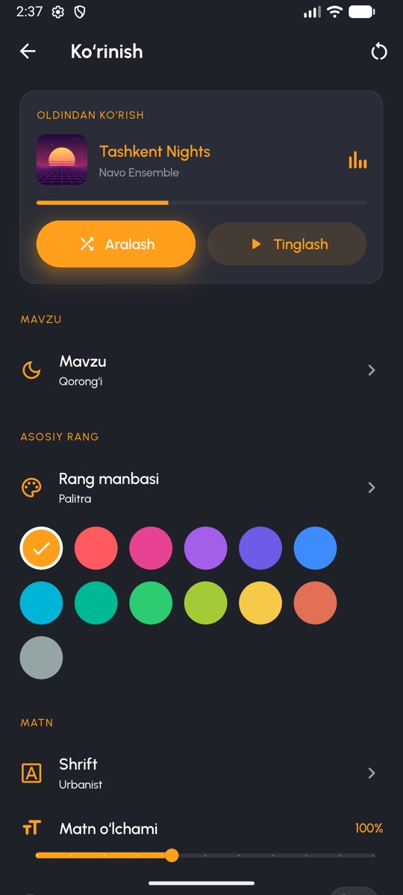

# Navo — oflayn musiqa pleyeri

Flutter'da yozilgan oflayn musiqa pleyeri: Android, Windows va macOS. Qurilmadagi qo'shiqlarni o'qiydi, internet talab qilmaydi. Interfeys **o'zbek**, **rus** va **ingliz** tillarida.

Dizayn va dasturlash: Feruzbek Namozboyev.

Joriy versiya: **1.2.0** — o'zgarishlar ro'yxati [CHANGELOG.md](CHANGELOG.md) faylida.

## Yuklab olish

Tayyor fayllar [Releases](https://github.com/Feruzbek0318/navo-music-player/releases/latest) sahifasida:

| Platforma | Fayl | O'rnatish |
|---|---|---|
| Android 5.0+ | `Navo-1.2.0-android.apk` | Telefonga yuklab oling va oching. "Noma'lum manbalardan o'rnatish"ga ruxsat berish so'ralishi mumkin. |
| Windows 10/11 (64-bit) | `Navo-1.2.0-windows-setup.exe` | *Tez orada qo'shiladi.* O'rnatuvchini ishga tushiring. SmartScreen chiqsa: **Batafsil → Baribir ishga tushirish**. |
| macOS 10.15+ (Intel va Apple Silicon) | `Navo-1.2.0-macos.dmg` | DMG'ni oching va Navo'ni **Applications** papkasiga torting. Birinchi marta: ilovani o'ng tugma bilan bosib **Open** tanlang (ilova Apple tomonidan imzolanmagan). |
| Manba kodi | `Source code (zip / tar.gz)` | Har bir relizga GitHub avtomatik qo'shadi. |

Kompyuter versiyalari foydalanuvchining **Musiqa** (`Music`) papkasidagi qo'shiqlarni (MP3, M4A, AAC, FLAC, OGG, Opus, WAV) o'qiydi.

## Ekran rasmlari

> Rasmlardagi qo'shiqlar — ilova bilan birga keladigan demo treklar.

| Tanishtiruv | Bosh sahifa | Qo'shiqlar |
|---|---|---|
|  |  |  |

| Pleyer | Qo'shiq matni | Ijro navbati |
|---|---|---|
|  |  |  |

| Sozlamalar | Ekvalayzer | Ko'rinish |
|---|---|---|
|  |  |  |

## Imkoniyatlar

### Kutubxona
- Qurilmadagi musiqani (MediaStore) skanerlaydi: Android 13+ (`READ_MEDIA_AUDIO`), Android ≤12 (xotira) va iOS (media kutubxona) ruxsatlari bilan.
- Bosh sahifa bo'limlari: **Tavsiyalar** (yaqinda tinglangan, ijrochilar, ko'p tinglangan), **Qo'shiqlar**, **Ijrochilar**, **Albomlar**, **Papkalar**. Saralash tanlovi eslab qolinadi.
- Qo'shiq menyusi: keyingi bo'lib ijro etish, navbatga qo'shish, pleylistga qo'shish, albom/ijrochiga o'tish, ma'lumotlar, qo'ng'iroq ohangi qilib qo'yish, bloklash, ulashish, qurilmadan o'chirish.
- Jonli qidiruv, oxirgi qidiruvlar tarixi bilan.

### Pleyer
- Vinil yoki kvadrat muqova, ijro chizig'i, −10 s / +10 s, aralash (shuffle), takrorlash (o'chiq / hammasi / bittasi), tezlik, uxlash taymeri (daqiqa yoki qo'shiq oxirigacha).
- Ekvalayzer, bas va balandlik kuchaytirgich, crossfade, ReplayGain, A-B takrorlash.
- Navbat: tartibini o'zgartirish, surib o'chirish; ilova qayta ochilganda oxirgi navbat tiklanadi.
- Fonda ijro, qulf ekrani va bildirishnomada boshqaruv tugmalari (`just_audio` + `audio_service`), bildirishnomada "sevimli" (yurakcha) tugmasi.
- Qo'shiq matni paneli: faqat foydalanuvchida bor matn o'qiladi — qo'shiq yonidagi `.lrc` fayl yoki fayl teglariga joylangan matn. Internetdan hech narsa yuklanmaydi.
- Mini pleyer pastki menyu ustida turadi; bosilsa yoki yuqoriga surilsa to'liq pleyer ochiladi, pastga surilsa yopiladi.

### Pleylistlar va sevimlilar
- Pleylist yaratish, nomini o'zgartirish, o'chirish, tartiblash; ichidagi qo'shiqlarni tartiblash.
- Sevimlilar, yaqinda va ko'p tinglanganlar, bloklangan qo'shiqlar — hammasi qurilmada Hive'da saqlanadi.

### Sozlamalar
- Asosiy / Kengaytirilgan bo'limlar, sozlamalar ichida qidiruv, har bir guruhni alohida tiklash.
- Ko'rinish: yorug' / qorong'i / AMOLED mavzu, urg'u rangi, burchaklar, zichlik, shriftlar.
- Imo-ishoralar (mini pleyerni surish, tebranish).
- Zaxira nusxa: sozlamalar, sevimlilar, pleylistlar va yashirin qo'shiqlarni JSON faylga saqlash va qayta tiklash.
- Til: qurilma tiliga moslashadi, sozlamalardan darhol almashtiriladi.

### Demo kontent
`assets/demo/` papkasida shu loyiha uchun kodda sintez qilingan to'rtta qisqa cholg'u trek, muqovalar va `.lrc` matnlar bor (CC0, `assets/demo/LICENSE.txt`). Shu sababli ilova telefonda musiqa bo'lmasa ham ishlaydi. Sozlamalardan bu treklarni yashirish mumkin.

## Ishga tushirish

```bash
flutter pub get
flutter gen-l10n
flutter run
```

Android emulyator yoki qurilma ulangan bo'lishi kerak.

Ilova belgisi va ochilish ekranini qayta yaratish (`assets/images/` o'zgarganda):

```bash
dart run flutter_launcher_icons
dart run flutter_native_splash:create
```

### Testlar

```bash
flutter analyze
flutter test
```

Testlar: LRC parser, saralash/guruhlash, qidiruv, saqlash, pleylistlar, audio handler, navbatni tiklash, sozlamalar modeli va zaxira nusxa, mavzu golden testlari (uz/ru/en).

### Talablar

- Flutter 3.47+ / Dart 3.13+
- Android: compileSdk 36, minSdk 21+. AGP 9.1 / Gradle 9.3.
- iOS: CocoaPods kerak (`sudo gem install cocoapods`, keyin `cd ios && pod install`). Pastga qarang.

### Kompyuter versiyalarini yig'ish

```bash
flutter build macos --release      # build/macos/Build/Products/Release/Navo.app
flutter build windows --release    # faqat Windows kompyuterda
```

Windows o'rnatuvchisi (EXE) Inno Setup bilan yig'iladi: [windows/installer/navo.iss](windows/installer/navo.iss). Windows kompyuterda `flutter build windows --release`dan keyin `iscc windows\installer\navo.iss` ishga tushiring — natija `build/release/` papkasida.

### Release build imzosi

Kalit fayllari (`key.properties`, `*.jks`, `*.keystore`) repozitoriyga kirmaydi — `.gitignore`da. Release APK uchun o'z kalitingizni yarating va `android/key.properties` faylini mahalliy saqlang.

## Ruxsatlar

| Platforma | Ruxsat | Nima uchun |
|---|---|---|
| Android 13+ | `READ_MEDIA_AUDIO` | Musiqa kutubxonasini o'qish |
| Android ≤12 | `READ_EXTERNAL_STORAGE` (maxSdk 32) | Musiqa kutubxonasini o'qish |
| Android ≤9 | `WRITE_EXTERNAL_STORAGE` (maxSdk 28) | Qo'shiqni o'chirish |
| Android 10+ | – | O'chirish tizimning tasdiqlash oynasi orqali (`MediaStore.createDeleteRequest`) |
| Android | `FOREGROUND_SERVICE`, `FOREGROUND_SERVICE_MEDIA_PLAYBACK`, `WAKE_LOCK`, `POST_NOTIFICATIONS` | Fonda ijro va bildirishnoma |
| Android | `WRITE_SETTINGS` | Qo'ng'iroq ohangi qilib qo'yish (birinchi marta tizim sozlamasi ochiladi) |
| iOS | `NSAppleMusicUsageDescription`, `UIBackgroundModes: audio` | Media kutubxona va fonda ijro |

**iOS + permission_handler:** `pod install`dan keyin `ios/Podfile`da media kutubxona ruxsatini yoqing:

```ruby
post_install do |installer|
  installer.pods_project.targets.each do |target|
    flutter_additional_ios_build_settings(target)
    target.build_configurations.each do |config|
      config.build_settings['GCC_PREPROCESSOR_DEFINITIONS'] ||= ['$(inherited)', 'PERMISSION_MEDIA_LIBRARY=1']
    end
  end
end
```

## Loyiha tuzilmasi

```
lib/
  main.dart                 Hive + AudioService (Windows/Linux'da media_kit) ishga tushirish
  app.dart                  MaterialApp, til tanlash, mavzu
  core/
    constants/app_info.dart Muallif kontaktlari (About ekrani)
    platform/               MainActivity.kt bilan MethodChannel (ringtone, o'chirish, audio chiqish)
    router/  storage/  theme/  utils/
  features/
    splash/  onboarding/  shell/
    library/    data/ · state/ (Riverpod) · ui/
    player/     data/ (audio handler, effektlar, ReplayGain, navbat, matn) · state/ · ui/
    playlists/  favorites/  search/  settings/
  l10n/         app_en.arb · app_ru.arb · app_uz.arb
  shared/widgets/
android/app/src/main/kotlin/uz/feruzbek/navo/MainActivity.kt
packages/on_audio_query_plus_android/   Plaginning tuzatilgan nusxasi (packages/README.md)
assets/  fonts/ (Urbanist, Manrope — OFL) · images/ · demo/ (CC0)
```

Holat har bir bo'limning `state/` papkasidagi Riverpod provayderlarida. Vidjetlar faqat provayderlarni o'qiydi; saqlash va platforma bilan ishlash `data/` repozitoriylarida.

## Yangi til qo'shish

1. `lib/l10n/app_en.arb`ni `app_<kod>.arb` deb nusxalang, `"@@locale": "<kod>"` qo'ying va tarjima qiling (`…Count` kalitlari uchun ICU plural).
2. Tilning o'z nomini sozlamalar ekranidagi tillar ro'yxatiga qo'shing.
3. Yozuv Urbanist yoki Manrope'da bo'lmasa, shrift qo'shib `AppTheme.fontFamilyFor`ni yangilang.
4. iOS: kodni `Info.plist`dagi `CFBundleLocalizations`ga qo'shing.
5. `flutter gen-l10n` ishga tushiring.

## Ma'lum cheklovlar

- Kompyuter versiyalarida faqat `Music` papkasi o'qiladi. Qo'ng'iroq ohangi, qo'shiqni o'chirish va teg muharriri faqat Android'da ishlaydi. Ekvalayzer va ovoz kuchaytirgich ham faqat Android'da.
- Windows'da tizimning media boshqaruvi (klaviatura media tugmalari, bildirishnoma) hali yo'q.
- "Audio chiqish" Android'ning tizim tanlagichini ochadi (Android 11+). iOS'da tanlagich yo'q, Chromecast qo'llanmaydi.
- `on_audio_query_plus_android` hali Kotlin Gradle Plugin'ni ishlatadi, shuning uchun build paytida "Built-in Kotlin" ogohlantirishi chiqadi. Build ishlaydi.

## Banner

`docs/banner.jpg` (README) va `docs/social-preview.png` (GitHub Social preview, 1280×640) [docs/banner/banner.html](docs/banner/banner.html) faylidan yasalgan. Ekran rasmlari yangilansa, shu HTML'ni Chrome headless bilan qayta suratga oling:

```bash
"/Applications/Google Chrome.app/Contents/MacOS/Google Chrome" --headless=new --hide-scrollbars --allow-file-access-from-files --window-size=1280,640 --screenshot=docs/social-preview.png "file://$PWD/docs/banner/banner.html"
```

## Litsenziyalar

- Shriftlar: Urbanist va Manrope, SIL Open Font License (`assets/fonts/OFL-*.txt`).
- Demo treklar, muqovalar va matnlar: CC0.
- `palette_generator` pub.dev'da eskirgan deb belgilangan, lekin ishlaydi.

## Aloqa

- Telegram: [@Namozboyev_Feruzbek](https://t.me/Namozboyev_Feruzbek)
- YouTube: [@feruzbek_namozboyev](https://www.youtube.com/@feruzbek_namozboyev)
